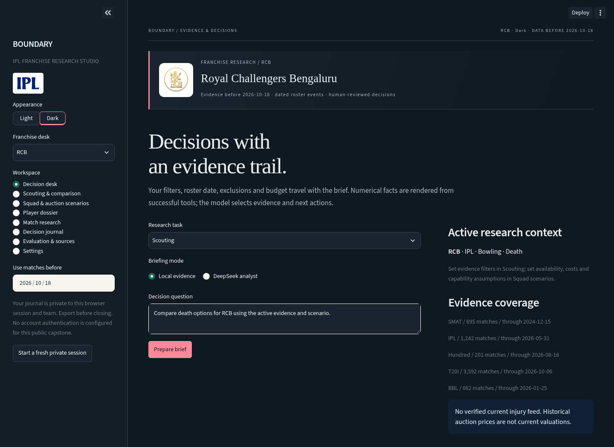

# Boundary — IPL franchise research studio

An independent capstone for analysts and scouts: dated match evidence, phase scouting, player dossiers, constrained XI and bowling plans, baseline match research, private-session journals and a bounded DeepSeek assistant.

**Live app:** https://br-abishek-07-boundary-cricket-capstone-app-g4476m.streamlit.app/



## Run

Python 3.11 or later is required.

```bash
pip install -r requirements.txt
streamlit run app.py
```

Or use `start.bat` / `bash start.sh`. The processed match data is included; raw uploads are not needed to launch the app.

For live DeepSeek, configure a **server secret**, never source code:

```toml
# .streamlit/secrets.toml locally, or Streamlit Cloud > App settings > Secrets
DEEPSEEK_API_KEY = "your-private-provider-key"
```

A `DEEPSEEK_API_KEY` environment variable or a private session override also works. No credential is included in this public repository. Local evidence mode works without an API key. Existing Streamlit hosting secrets survive a normal source update.

## What changed in the corrective release

- Fixed shared missing-ID collisions; canonical names preserve raw archive aliases and registry IDs.
- Applied exclusive date cutoffs, known sourced roster events, and a clear block on unsupported historical squad reconstruction.
- Read recorded powerplay boundaries for reduced innings; death remains an explicitly defined analytical window. Phase wickets and dismissals now reconcile with totals.
- Added one-year recency decay and dismissal/wicket components to transparent shrinkage scores. ALL competitions stay in separate groups.
- Added joint XI and bowling allocation: 11 players, overseas/keeper/role constraints, supported spin/pace options, 36/60/24 phase balls and at most 24 balls per player. Unsupported evidence requires a written scenario assumption.
- Preserved exclusions, locks, prices and constraints in the AI's XI tool. Comparisons, dossier statistics and uncertainty share filters.
- Replaced unrestricted generated numerical claims with tool-backed fact rendering. Excess tool calls get valid deferred responses. Failed requests clear old answers.
- Isolated journals, reviews and caches by random session and franchise. Legacy shared journals are never read. Anonymous sessions are not authenticated team accounts.
- Added a stronger training-derived chase baseline. The research model failed its acceptance gate; the UI serves the baseline and retains model results for scrutiny.
- Added bundled franchise crests and vector IPL text mark, team accents, Light/Dark control, readable research tables and responsive typography.

## Workspaces

| Workspace | Purpose |
| --- | --- |
| Decision desk | Local evidence or DeepSeek selection of verified tool facts, with source records and active scenario |
| Scouting & comparison | Separate league and phase evidence, raw samples, recency-weighted descriptive scores and observed-rate intervals |
| Squad & auction scenarios | Dated membership, availability, locks, supported workloads and editable XI cost assumptions |
| Player dossier | Resolve names/aliases, inspect filtered match evidence and manually search historical auction records |
| Match research | Training-derived chase baseline, failed-model gate, dated holdouts and calibration |
| Decision journal | Session-and-team-scoped briefs, scenarios and exports |
| Evaluation & sources | Actual release checks, source manifests, dated roster events and unassessed reviewer form |
| Settings | Private session credential override and provider allowance status |

## Evidence and methods

6,392 eligible men's matches; 141,377 named player-match records. Sources cover IPL, BBL, SMAT, Hundred and T20I. Source hashes, exclusions and dates are in `data/audit.json`. Auction history covers 2013–2022; it is not a current pricing source.

Use [the methods and boundaries](docs/DATA_SOURCES.md), [the user guide](docs/USER_GUIDE.md) and [release notes](docs/RELEASE_NOTES.md). Dated trade events have source links in `data/squad_events.json`; they do not establish a fully verified current squad. Reference bowling styles are curated planning tags, open to justified overrides.

Scores use recency-weighted rates and a 120-ball prior. The batting heuristic includes dismissal rate; bowling includes conceded runs and wicket rate. Coefficients are research assumptions, not learned future values. Match-bootstrap intervals use 500 seeded samples and describe observed rates in the selected scope.

The retrospective research model is trained before 2023, validated on 2023, and tested on 2024 onward with same-day outcome isolation. It must beat the training-derived chase-rate Brier score on both validation and test to be served. It currently fails. This release uses 50% before toss and the historical training chase rate after a chasing side is specified. No predictive advantage is claimed.

## Validation

```bash
python tests/test_core.py
python tests/test_ui.py
```

The release artifacts in `data/release_checks.json`, `test_results.json`, `ui_results.json` and `browser_results.json` contain actual outcomes and scope. Provider fixtures do not spend API credit. The original-snapshot comparison is skipped when that external audit snapshot is absent; the other checks run from this repository.

To rebuild from the original uploads:

```bash
python match_data.py --source /path/to/archives --output data
python prediction.py
```

Documentation artifacts can be regenerated using `pip install -r requirements-docs.txt` and `python tools/build_docs.py`.

## Deployment and boundaries

Streamlit Community Cloud: repository `br-abishek-07/boundary-cricket-capstone`, branch `main`, entrypoint `app.py`, Python 3.11+. Store the DeepSeek key only in hosting secrets.

This is a research capstone, not a confidential franchise system. Account authentication, durable shared team storage, a verified current injury/availability feed, full Impact Player or competition eligibility certification, market valuation and proven predictive edge are not implemented. Local SQLite storage and daily allowances are installation-local and can reset on redeploy. Export work before closing a session. The six-calls/session and thirty-calls/installation limits do not replace provider billing controls or authenticated access.

IPL and franchise marks identify the subjects of this independent educational project. Attribution is in `assets/sources.json`; no endorsement is implied. Source-data rights remain those of their owners; check applicable terms before wider redistribution.
