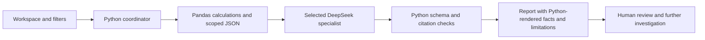

# IPL Intelligence 360° — Hybrid 6-Agent Architecture

IPL Intelligence 360° supports franchise research using supplied match, player, auction and squad records. Its contribution is an inspectable decision-support workflow: calculate evidence, select a specialist, validate the response, and retain citations and limitations for human review.

## Six logical roles

| Role | Implementation | Responsibility |
| --- | --- | --- |
| Player Scout | DeepSeek specialist prompt | Interpret scoped player statistics and recent evidence. |
| Matchup Analyst | DeepSeek specialist prompt | Interpret historical head-to-head and venue samples. |
| Auction Analyst | DeepSeek specialist prompt | Explain historical recorded amounts and category distributions. |
| Squad Analyst | DeepSeek specialist prompt | Review supplied role/origin metadata and qualified coverage questions. |
| Research Coordinator | Python workspace routing and evidence builders | Route the selected task and assemble its filtered context. |
| Evidence Reviewer | Python input/output validation and UI rendering | Check schema, known fact references and bounds; display calculated facts and required limitations. |

The coordinator is selection-driven application logic. The reviewer checks structure and references; it is not an independent professional analyst or a proof that every qualitative claim follows from its citations. Four roles make specialist LLM requests. This is not six autonomous models debating or six API calls per action.



## Empirical Evidence First

Pandas owns numerical calculations. The LLM receives a bounded JSON packet containing calculated facts, source context, selected supporting rows and limitations. Reports separate observations from tentative interpretations and cite known fact IDs. Missing values, unavailable currency definitions and uncertain roster metadata remain explicit.

JSON parsing accepts plain JSON and enclosing Markdown fences. Schema, reference and output-bound checks reject unsupported structures and unknown IDs. Numerical facts are rendered by Python. These controls reduce some unsupported outputs; they do not guarantee hallucination-free language, complete official source coverage, tactical usefulness or forecast superiority.

Reports are generated only on explicit button clicks. The SDK is imported lazily when needed. Each specialist has a separate browser-session report record bound to evidence, model and prompt version. Context changes invalidate its display. Provider failures leave the statistical workspaces usable. A content-versioned local agent loader protects against mixed cached module releases.

## Stack and file map

- Python: control flow, validation, hashing and request handling.
- Streamlit: workspaces, selection controls, cached loaders and session-bound reports.
- Pandas: record filtering, totals, rates and category counts.
- DeepSeek API: structured specialist interpretation through the OpenAI-compatible Python client.
- `data_loader.py`: five cached dataset loaders.
- `app.py`: workspaces, deterministic evidence builders, report presentation and local status checks.
- `agents.py`: specialist prompts, shared client, JSON parsing and response checks.
- `agent_runtime.py`: repository-local, content-versioned agent loading.

## Home status semantics

Home checks whether the five loaded dataframes contain records, whether the local agent release loaded, whether the optional SDK package is discoverable, and whether credentials/model settings are present and readable. It never displays credential values and never initializes the provider client or makes a paid request.

“AI configuration ready” means those local configuration checks passed. It does not prove SDK importability, API authentication, endpoint availability or report quality. Those are assessed separately during actual report requests. Missing credentials or optional agent components do not imply that the loaded statistical data is unavailable.

## Reproduction and scope

Install the repository requirements and run `python -m streamlit run app.py`. Configure the private DeepSeek key in Streamlit Secrets to enable reports. Follow the individual agent guides in `docs/` for evidence semantics and testing. The source datasets have different historical coverage; squad registration and auction units are not certified current or complete.

Focused checks cover provider contracts, evidence arithmetic, caching, runtime loading and the Home status states. They use mocked provider responses and do not certify a live cloud rebuild or model quality.

```text
python -m unittest discover -s tests -p "test_*agent*.py" -v
python -m unittest discover -s tests -p test_home_overview.py -v
```
