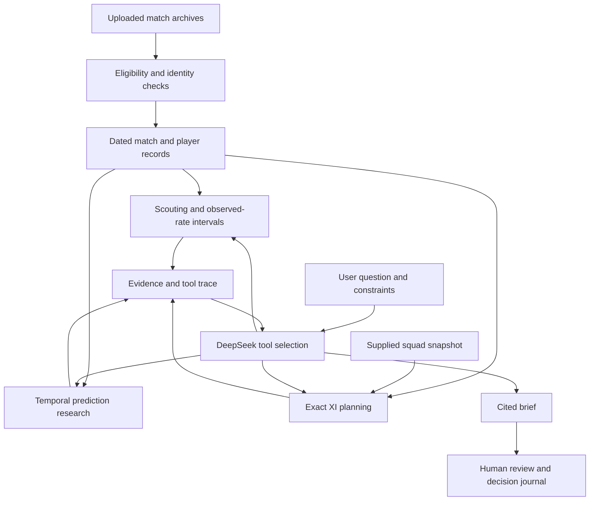

# Integrated product blueprint

## Objective and scope
A single capstone release for franchise analysts and scouts, combining data engineering, local decision tools, AI research, custom UX and evaluation. The deliverable is one runnable application rather than separately released stages. Live feeds, video understanding and guaranteed predictive superiority are outside the available evidence/resources.

## SWOT and response
| Dimension | Finding | Implemented response |
|---|---|---|
| Strength | Rich uploaded match history | Unified match-level database and source manifest |
| Strength | Structured squad roles | Exact feasibility solver and full-bench accounting |
| Weakness | Season aggregates can leak future matches | Strict match-date cutoffs |
| Weakness | Auction data ends in 2022 | Historical lookup and explicit scenario prices |
| Weakness | Limited demonstrated prediction edge | Untouched test, Brier/log loss, calibration and uncertainty |
| Opportunity | Explainable scouting decisions | Compare candidates, dossiers and inspectable AI tool traces |
| Opportunity | Learning from decisions | Local journal and actual review form |
| Threat | Unsupported AI claims | Bounded tool access, evidence requirement and human review |
| Threat | Stale availability | User-defined exclusions with source-status disclosure |
| Threat | API spending | Persistent local allowance, token limits and caching |

## Architecture

## Intelligence and reliability
DeepSeek chooses four approved tool types: scouting, dossier, lineup solving and match research. The local tools calculate numbers. The analyst must retrieve evidence before a final brief is accepted, but generated prose is not claim-by-claim verified. Typed arguments, source separation, bounded turns, finite JSON serialization, explicit failure states, caching and private credentials constrain execution. A second language-model reviewer is not simulated or claimed.

## Evaluation
37 offline behavioral checks and 12 UI workflow checks are recorded in the delivered reports. Desktop/mobile browser screenshots were inspected. Prediction uses a fixed temporal train/validation/test protocol with no test tuning. Qualitative evaluation is implemented as a real review workflow; reviewer ratings remain pending. Live API answer quality is not established because provider-host access is unavailable in the build environment.

## UX rationale
Editorial headings, restrained franchise-research colors, whitespace and evidence-focused tables replace decorative agent activity. Eight workspaces follow research tasks. Explain limitations at the point of use, keep costs labeled as assumptions, and preserve scenario settings in the journal. Browser rendering checks are not a substitute for usability testing with analysts.

## Scientific and practical limits
No learned scouting forecast, competition-strength translation, real-time injury feed, official rule certification or current market valuation is asserted. The probability model excludes player lineups and weather. Wilson intervals do not model season dependence. Dataset availability does not establish redistribution rights. Storage and rate accounting are local to one replica. These boundaries are documented in the app and project report.
